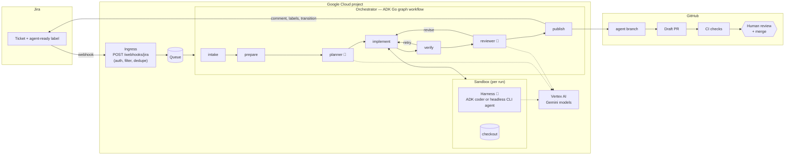
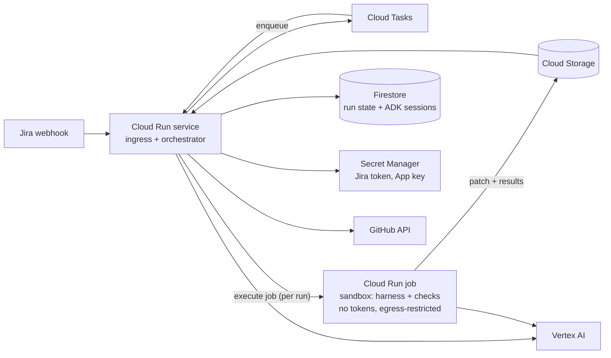

# ticketflow — design

**Goal:** a Jira ticket becomes a reviewed-quality pull request with no human involvement
between "this ticket is ready" and "here is the PR", while **nothing merges without a
human**. **Constraints:** orchestration on Google's Agent Development Kit (ADK) in Go;
models hosted on Vertex AI; Google Antigravity as the coding harness, or a strong case
for anything else.

## Contents

1. [The short version](#the-short-version)
2. [Where the humans are](#where-the-humans-are)
3. [Architecture](#architecture)
4. [The pipeline](#the-pipeline)
5. [The harness question: where Antigravity fits](#the-harness-question-where-antigravity-fits)
6. [The merge gate](#the-merge-gate)
7. [Security model](#security-model)
8. [Running it on Google Cloud](#running-it-on-google-cloud)
9. [What the prototype covers](#what-the-prototype-covers)
10. [Alternatives, and how to argue for them](#alternatives-and-how-to-argue-for-them)
11. [Decisions to make](#decisions-to-make)
12. [Rolling it out](#rolling-it-out)

## The short version

- **It is feasible on the Google stack.** ADK Go orchestrates, every model call goes to
  Vertex AI, and GitHub — not the agent — enforces the merge gate. The prototype in this
  directory runs the whole pipeline up to an opened draft PR.
- **The part that does not fit cleanly is Antigravity as the *unattended* harness.**
  Antigravity is built around a developer at a desktop supervising agents (an editor plus
  an agent manager). A pipeline with no human in the loop needs a harness that starts
  headless in a sandbox, takes a task, and exits. Unless Antigravity offers a supported,
  documented non-interactive mode (verify this before committing to it — see
  [below](#what-to-verify-about-antigravity)), it cannot be that component.
- **So give each harness the job it fits.** The unattended path uses **ADK itself** as
  the coding harness — the chosen option: pure Go, pure Google, one binary. It sits
  behind a Go interface, so another headless agent can be compared or swapped in later
  without touching the pipeline. Antigravity is where *people* work on the
  same tickets: writing and refining tickets and skills, reviewing agent PRs and pushing
  fixes to them, and picking up escalations. Both read the same repository instructions
  (`AGENTS.md`, Agent Skills), so they behave alike.
- **If Antigravity does gain a headless mode, it drops into the `cli` harness** with a
  configuration change; nothing else in the pipeline moves.
- **Human judgement moves to the ends, not out.** Ticket quality gates the input; human
  review and merge gate the output. Everything in between has a deterministic backstop.

## Where the humans are

"No human in the loop" is achieved by moving human judgement to the two ends of the
pipeline, not by removing it:

| Before the trigger | Inside the pipeline | After the PR |
|---|---|---|
| A person writes a ticket with acceptance criteria and adds `agent-ready`. That label is the authorisation; restrict who can set it with a Jira permission scheme or an Automation rule. | Nobody. Every judgement call has a deterministic backstop (gates, checks, budgets), and every dead end reports back to the ticket instead of waiting for someone. | Code owners review a PR that is labelled as agent-authored, opened as a draft, and carries the plan, the checks, and the agent's unresolved self-review findings. A human approves and merges. |

The most important consequence: **ticket quality becomes the bottleneck.** A ticket that
two engineers would implement differently will be implemented by the agent in a third
way. The readiness gate (structural) and the planner (judgement) exist to bounce those
tickets back with specific questions rather than guess.

## Architecture

Three properties carry the design:

1. **The orchestrator is deterministic; models are consulted, not obeyed.** The graph,
   the gates, the budgets, and every write to Jira and GitHub are ordinary Go. Models
   plan, code, and review inside nodes, and the graph decides what happens next.
2. **The harness is untrusted and replaceable.** It receives a checkout and a task, and
   its output is judged by the orchestrator: the diff is computed from git, the checks are
   re-run, and the gates are applied. A harness's own summary goes into the PR for
   reviewers and decides nothing.
3. **Credentials and code never meet.** Only the orchestrator holds the GitHub and Jira
   tokens. Whatever runs agent-written code (the harness, the checks) gets a scrubbed
   environment and, in production, a separate sandbox.

## The pipeline

The run is an ADK Go **graph workflow** (`google.golang.org/adk/v2/workflow`):
function nodes for deterministic steps, single-turn `LlmAgent` nodes for the planner and
reviewer, and routed edges for every outcome. The prototype in this directory implements
all of it.

| Node | Kind | What it does | Exits |
|---|---|---|---|
| `intake` | function | Reads the ticket via the API, resolves the repo (project map or an allow-listed `repo:` label), applies the readiness gate, claims the ticket. | `ready`, `not_ready` |
| `prepare` | function | Clones the base branch, loads `.ticketflow.json` from the **base commit**, refuses if the agent branch already exists, creates it. | `ok`, `blocked` |
| `planner` | LLM agent (read-only tools) | Explores the repo; returns `ready` + plan + test plan + risk, or `not ready` + questions. | → `triage_plan` |
| `triage_plan` | function | Parses the plan; the planner's "not ready" is the second half of the readiness gate. | `go`, `not_ready`, `invalid` |
| `implement` | function → harness | One coding attempt with the previous attempt's feedback. A harness error becomes feedback, not a crash. | → `verify` |
| `verify` | function | Diff gate (size, protected paths, deleted tests, secrets), then every repo check. | `pass`, `retry`, `give_up` |
| `reviewer` | LLM agent (read-only tools) | Reviews the diff against the acceptance criteria; findings are `blocking` or `minor`. | → `triage_review` |
| `triage_review` | function | Blocking findings go back once (configurable); past the budget the PR opens with them listed first. | `revise`, `publish` |
| `publish` | function | Commit, push, open a draft PR, label it, comment on and transition the ticket. | terminal |
| `bounce` | function | Posts the questions on the ticket and removes the trigger label. | terminal |
| `escalate` | function | Posts the reason, adds `agent-needs-human`. | terminal |

Why a graph rather than an agent that orchestrates itself: the order of operations and
the stopping rules are policy, and policy should be reviewable code with tests, not a
paragraph in a prompt. ADK's graph workflow gives that while keeping the LLM steps
first-class (events, sessions, tracing, the ADK dev UI) — and its `RequestInput`
interrupt is the mechanism for the durable CI wait described under
[what the prototype covers](#what-the-prototype-covers).

### Gates

| Gate | When | Checks |
|---|---|---|
| Readiness | intake | Allowed issue types; blocking labels (`agent-blocked`, `needs-design`, `security`); a real description; acceptance criteria (heading, checklist, or Given/When/Then). |
| Repository opt-in | prepare | `.ticketflow.json` exists at the base commit and declares at least one check. |
| Diff | verify | Non-empty; file and line limits (a repo may tighten, never loosen); protected paths (`.github/workflows/**`, `CODEOWNERS`, the policy file, key material, plus repo additions); no deleted test files; no credential-shaped strings on added lines. |
| Checks | verify | Every repository check passes, run by the orchestrator with a scrubbed environment and a timeout. |
| Budgets | verify, triage_review | `MaxAttempts` implement/verify cycles; `MaxRevisions` review cycles. |

## The harness question: where Antigravity fits

A *coding harness* is everything around the model that turns "implement this" into a
correct change: the agent loop, file and search tools that work on large files, a way to
run builds and tests, context management over long sessions, and a sandbox. ADK is an
agent *framework* — it supplies the loop, tools, sessions, and workflow graph, but the
coding-specific parts are yours to build. That is the trade the options below make.

| Harness | Runs unattended? | Stays on Google? | Trade-off |
|---|---|---|---|
| **ADK coder** (`TICKETFLOW_HARNESS=adk`) — **chosen** | Yes — it is a Go function call. | Fully: ADK + Vertex AI, one binary. | You own harness quality: tool design, context compaction, prompt tuning. The prototype's tools (confined read/search/edit/write + named checks) are a solid start, not a finished product. |
| **Gemini CLI** (`cli`) | Yes — Google's open-source terminal agent has a non-interactive prompt mode with JSON output and an auto-approve mode, and authenticates to Vertex AI. | Yes: Google-maintained, Vertex-backed. | A Node.js process in the sandbox; its behaviour changes with its releases, so pin the version. Less code for you to own. |
| **Antigravity** | Only if it offers a supported headless entrypoint (unverified). | Yes. | The natural fit for the *human* side of this workflow regardless. |
| **Jules** (Google's hosted async coding agent) | Yes, as a service. | Yes. | It owns the sandbox and the branch, so the orchestrator cannot judge a diff before it reaches GitHub; the gates move to CI. |

**Decision: the ADK coder.** Orchestration and coding share one Go codebase on ADK and
Vertex AI, with no second runtime to install, pin, or sandbox separately. The cost is
that harness quality is this project's to build (see
[what the prototype covers](#what-the-prototype-covers)). The `cli` seam stays: if
someone later proposes another harness, the same set of historical tickets run in
dry-run mode through both settles it on check pass rate and reviewer acceptance (see
[rolling it out](#rolling-it-out)).

### What to verify about Antigravity

Before treating Antigravity as the unattended harness, confirm in its current
documentation:

1. a supported, documented way to run a task **non-interactively** (a CLI or API) that
   exits with a result, in a Linux container, without a desktop session;
2. that its terms permit **automated, server-side use** under your organisation's
   account, and which model backends it uses (Vertex AI in your project, or a Google
   consumer endpoint) — this decides data residency and logging;
3. how it reads repository instructions (rules, workflows, skills, `AGENTS.md`), so the
   pipeline and developers share one set.

If 1 is missing, use Antigravity for the human side and a headless harness for the
pipeline. If 1–3 hold, configure it as the `cli` harness:
`TICKETFLOW_HARNESS_COMMAND=<entrypoint> … {prompt_file} … {workdir}`.

### One set of instructions for people and agents

Whatever the harness, the repository carries the instructions: `AGENTS.md` for
conventions, Agent Skills (`SKILL.md` directories) for repeatable procedures, and
`.ticketflow.json` for the pipeline's checks and limits. The ADK coder loads skills from
`.agents/skills`, `.agent/skills`, and `.gemini/skills` through ADK's `skilltoolset`.
A skill written once — "add an API endpoint here" — then guides a developer in
Antigravity and the unattended agent alike.

## The merge gate

"Nothing merges without a human" is enforced by GitHub, not by the agent behaving.
Layered, from strongest:

1. **A branch ruleset on the default branch** (Settings → Rules → Rulesets), active,
   with **no bypass actors** that include the agent's identity:
   - require a pull request before merging, with **≥ 1 approval**;
   - **require review from Code Owners**;
   - **dismiss stale approvals when new commits are pushed**;
   - **require approval of the most recent reviewable push** — so an approval cannot be
     carried over a commit the agent pushed after it;
   - require status checks to pass, and require branches to be up to date;
   - block force pushes and deletions.
2. **GitHub itself:** a PR's author cannot approve their own PR, so the agent's identity
   cannot satisfy the approval rule on its own PRs.
3. **The agent's identity is minimal.** A dedicated GitHub App with `contents: write`,
   `pull_requests: write`, `metadata: read` on the onboarded repositories only — no
   `administration`, no `workflows` (so it cannot push changes under `.github/workflows`
   at all), never listed as a bypass actor, never a code owner.
4. **Agent branches are fenced.** A second ruleset restricting creation/updates of refs
   outside `ticketflow/**` for the App keeps it off every other branch.
5. **The code has no merge path.** `internal/github` implements no merge, approve, or
   auto-merge call; adding one is a reviewable change.
6. **Process signals.** PRs open as drafts, labelled `agent-authored`, with the risk
   estimate and unresolved findings at the top.

Layers 1–3 are sufficient by themselves; 4–6 limit the blast radius if the App's token
leaks.

## Security model

The threat that matters most is **prompt injection through the ticket.** Anyone who can
write in a ticket (or in a comment, or in a file the repo already contains) can address
the models. The design assumes they will, and limits what a fooled model can do:

| Control | Where |
|---|---|
| The trigger is a label set by authorised people, not "any new ticket". | Jira permissions; `TICKETFLOW_TRIGGER_LABEL` |
| The webhook body is used only for the issue key; content is re-read via the API. | `internal/jira/webhook.go` |
| Deliveries are authenticated (HMAC `X-Hub-Signature`, or a shared token header for Automation rules). | `jira.Authentic` |
| Ticket text is fenced as data in every prompt, and every prompt says so. | `internal/prompts` |
| Repositories are allow-listed; a `repo:` label cannot point outside the list. | `config.RepoAllowed` |
| The policy file is read before the agent runs and is itself protected, so a run cannot loosen its own rules. | `prepare`, `gate.DefaultForbidden` |
| CI config, CODEOWNERS, and key material are unchangeable by the agent; deleted tests are rejected. | `gate.Diff` |
| File tools are confined to the checkout; `..`, absolute paths, symlink escapes, and `.git/` are refused. | `repotools.Resolve` |
| Git hooks are disabled for every git command ticketflow runs, so a hook planted by the agent never executes. | `workspace` (`core.hooksPath`) |
| Tokens reach git through per-process `GIT_CONFIG_*` env vars, never `.git/config` or argv; errors are redacted. | `workspace` |
| Child processes (checks, CLI harness) get `PATH`, `HOME`, and an explicit allowlist only. | `workspace.Run` |
| The ADK harness cannot run arbitrary commands — only the repo's named checks. | `repotools.ReadWrite` |

**The limit of the prototype:** in `run`/`serve` mode everything shares one machine and
one OS user. A check that runs agent-written code (`go test` does) could read the
orchestrator's environment through `/proc` and reach the network. That is acceptable on a
developer laptop with a personal token and not acceptable in production. Production
splits the two: the orchestrator holds credentials and never executes repository code;
each run's harness and checks execute in a **separate sandbox with no credentials and
restricted egress**, and hand back a patch.

## Running it on Google Cloud

| Concern | Service | Notes |
|---|---|---|
| Ingress + orchestration | Cloud Run service | Scales to zero. Long LLM work runs inside a Cloud Tasks-delivered request, not after the 202, so CPU stays allocated. |
| Durable queue + retries | Cloud Tasks | One task per ticket; task name = issue key + timestamp for de-duplication. |
| Sandbox | Cloud Run jobs (gVisor) or GKE Autopilot with GKE Sandbox | One execution per attempt; the repository's toolchain image (e.g. its devcontainer). No service-account access to secrets; VPC egress limited to Vertex AI and package mirrors (Artifact Registry remote repositories). |
| Models | Vertex AI | Gemini via `google.golang.org/adk/v2/model/gemini` with `Backend: genai.BackendVertexAI`; Application Default Credentials. |
| State | Firestore | Run records, the per-ticket lock, and — for the CI wait — a durable ADK `session.Service`. |
| Secrets | Secret Manager | Jira API token, webhook secret, GitHub App private key; the orchestrator mints 1-hour installation tokens per run. |
| Observability | Cloud Logging, Cloud Trace | ADK emits OpenTelemetry spans per agent, node, model call, and tool call. |

## What the prototype covers

Implemented and tested here (offline: a scripted fake model, local git remotes, fake
Jira and GitHub):

- the full graph above, every route exercised by `internal/pipeline` tests through the
  real ADK runner;
- Jira REST (issue read with ADF→Markdown, comments with ADF, labels, transitions) and
  webhook authentication;
- GitHub PR opening with idempotent "already exists" handling, and labels;
- both harnesses, the ADK one driven through a real tool call by the fake model;
- the gates, the path-confined tools, and the git safety properties (no persisted token,
  no hooks).

Not built yet, in the order they would matter:

1. **The sandbox split** described under [security](#security-model): the harness and
   checks in a separate credential-less execution environment returning a patch.
2. **GitHub App authentication** (installation tokens) instead of a static token.
3. **The CI loop after the PR opens.** The `publish` node would continue to an
   `await_ci` node that emits an ADK `RequestInput` interrupt; with a durable
   `session.Service` (Firestore), the paused run survives scale-to-zero, and a GitHub
   `check_run` webhook resumes it with the conclusion. Failure routes back to `implement`
   with the CI log as feedback; success ends the run.
4. **Review-comment follow-up.** The same pause/resume, resumed by
   `pull_request_review` events, so the agent addresses review comments by pushing
   commits — still never merging.
5. **A durable queue and lock** (Cloud Tasks + Firestore) in place of the in-process
   worker pool, so `serve` can run on Cloud Run.
6. **Hardening the ADK coder.** Context management for long sessions (summarising old
   tool output instead of carrying it), a way to run one test or package rather than the
   full check for faster iteration, and tuning `implementer.md` against the evaluation set.
7. **Evaluation.** A fixed set of historical tickets with their merged PRs, replayed in
   dry-run mode against each prompt or model change, scoring check pass rate, diff
   similarity, and reviewer-acceptance.

## Alternatives, and how to argue for them

The pipeline uses ADK for both orchestration and coding. This section is reference for
anyone who proposes another harness later: the seam makes most of them a configuration
change, so the way to argue for one is the evaluation set, not a feature list — same
tickets, same gates, same checks, compare the outcomes.

| Option | What it is | When it is worth the argument |
|---|---|---|
| **Gemini CLI** | Google's open-source terminal coding agent; headless mode, Vertex AI auth, an official GitHub Action. | The easiest case to make: it is Google's, so it stays inside the constraint, and it removes harness engineering from your backlog. |
| **Jules** | Google's hosted asynchronous coding agent that works on a GitHub repo and produces a branch/PR. | When you would rather not run sandboxes at all. You give up judging the diff before it reaches GitHub. |
| **Goose** (Block) | Open-source, model-agnostic agent with a CLI, headless runs, and MCP extensions. | If a non-Google harness is acceptable and you want one that is not tied to a vendor; it can use Vertex AI models. |
| **BuilderBot** (Block) | From Block, the company behind Goose. Not evaluated here. | — |

What is *not* worth replacing: the orchestrator. Jira intake, gates, budgets, the merge
gate, and reporting are deterministic code that every harness option still needs, and
ADK Go is a reasonable home for it.

## Decisions to make

Decided: **ADK Go for orchestration and for the unattended coding harness**, with models
on Vertex AI; Antigravity for the human side.

1. **Models per role** (`TICKETFLOW_PLANNER_MODEL`, `_CODER_MODEL`, `_REVIEWER_MODEL`):
   which Gemini models, and whether third-party models from Vertex AI Model Garden are in
   bounds. ADK Go ships a Gemini model; any other needs a small `model.LLM` adapter.
2. **The trigger:** a label (as built) or a workflow status such as "Ready for Agent",
   and who may set it.
3. **The sandbox:** Cloud Run jobs or GKE Sandbox, and the egress allowlist.
4. **PR posture:** drafts (as built) or ready-for-review; reviewer assignment by
   CODEOWNERS or by the ticket's team.
5. **Scope of autonomy after the PR:** stop at the PR (as built), or also fix CI
   failures and answer review comments (see items 3–4 of
   [what the prototype covers](#what-the-prototype-covers)).
6. **Where it lives:** this directory is self-contained so it can move to its own
   repository unchanged.

## Rolling it out

1. **Dry run on history.** Pick 20–50 closed tickets whose merged PRs are known-good.
   Run `ticketflow run -dry-run` on each against the parent commit; compare. This sets
   the bar before anyone sees an agent PR.
2. **One team, one repository, low-risk ticket types** (bugs with a reproduction, small
   stories with crisp criteria), drafts only, with the team choosing which tickets get
   the label.
3. **Measure** what reviewers care about: PRs merged without rework, PRs closed unmerged,
   review comments per PR, time from label to PR, bounce rate (a high bounce rate is a
   ticket-quality signal, not an agent failure).
4. **Widen** by repository and ticket type only when those numbers hold.
